<!--
  GitHub profile README for Hussain Hassan Butt (hussainbutt1200-wq).
  Keep the assets/ folder and .github/workflows/snake.yml next to this file.
-->

  

<picture>
  <source media="(prefers-color-scheme: dark)" srcset="assets/h-about-dark.svg">
  
</picture>

I co-founded **[Aksali Technologies](https://aksali.com)** to build software the way it should be built: fast, scalable and designed around the people who use it. I work across the whole stack, from React and Next.js interfaces to Node.js services to the deep learning models behind them.

Before Aksali I shipped production frontends at **Devsinc** and client work at **NETSOL Technologies**. I'm now doing an MSc in Computer Science at **Ulster University London**, focused on knowledge engineering and machine learning, and putting that research to work in real products.

<table>
  <tr>
    <td width="33%" valign="top">CURRENTLY <b>Building client products at Aksali</b></td>
    <td width="33%" valign="top">RESEARCHING <b>Knowledge engineering &amp; applied ML</b></td>
    <td width="33%" valign="top">OPEN TO <b>Partnerships, products &amp; AI ideas</b></td>
  </tr>
</table>

 

<picture>
  <source media="(prefers-color-scheme: dark)" srcset="assets/h-aksali-technologies-dark.svg">
  
</picture>

  

<picture>
  <source media="(prefers-color-scheme: dark)" srcset="assets/h-stack-dark.svg">
  
</picture>

  

<picture>
  <source media="(prefers-color-scheme: dark)" srcset="assets/h-journey-dark.svg">
  
</picture>

  

<picture>
  <source media="(prefers-color-scheme: dark)" srcset="assets/h-selected-work-dark.svg">
  
</picture>

  
  

  
  

 

<picture>
  <source media="(prefers-color-scheme: dark)" srcset="assets/h-activity-dark.svg">
  
</picture>

<picture>
  <source media="(prefers-color-scheme: dark)" srcset="https://raw.githubusercontent.com/hussainbutt1200-wq/hussainbutt1200-wq/output/snake-dark.svg">
  
</picture>

  

 

<picture>
  <source media="(prefers-color-scheme: dark)" srcset="assets/h-connect-dark.svg">
  
</picture>

  
  
  
  
  

 

